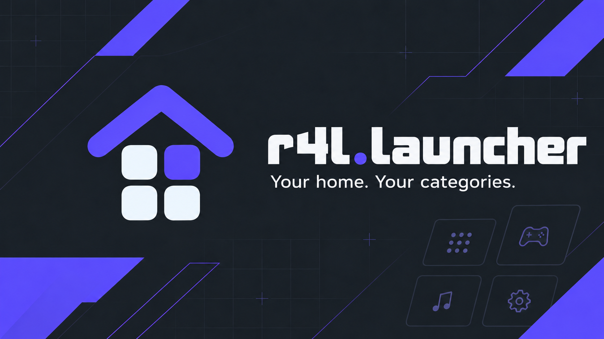

# r4l.launcher



A personal Android launcher by [Rafael Maciel](https://r4l-blog-v2.vercel.app/),
with offline app categories, bottom drawer search, and a charcoal and violet R4L identity.
Built on [Murine Launcher](https://github.com/alesimula/Murine-launcher) and AOSP Launcher3.

## What it does

- Optional category tabs with local sorting, editable groups, and swipe navigation.
- App search at the bottom of the drawer, above the keyboard.
- Home-screen grids, widgets, icon packs, gestures, and launcher backups inherited from Murine.
- Android 8 and above. Blur effects need Android 12 and device support.

Category tabs and bottom search are off by default. Enable them in **Launcher settings → App drawer**.

## Build

Use JDK 21 and Android SDK platform `android-37.2`.

```sh
./gradlew :testAospWithoutQuickstepDebugUnitTest :assembleAospWithoutQuickstepDebug
```

The debug APK is in `build/outputs/apk/aospWithoutQuickstep/debug/`.
See [FORK.md](FORK.md) for installation, behavior, maintenance, and device validation.

## Branding

The [brand assets](image/brand/README.md) include the transparent generated logo,
SVG mark, Android icons, and project cover. The palette follows
[R4L Blog v2](https://r4l-blog-v2.vercel.app/). The launcher has its own home-and-app-grid symbol.

## Credits and license

This fork builds on [alesimula's Murine Launcher](https://github.com/alesimula/Murine-launcher),
which builds on [yuchuangu85's Launcher3](https://github.com/yuchuangu85/Launcher3) and AOSP.
Original copyright notices, [LICENSE](LICENSE), and [NOTICE](NOTICE) are retained.
Inherited preview art is by [Miikrowelle](https://miikrowelle.straw.page).
Some icons come from [Lets Icons by sadik sajid](https://www.figma.com/community/plugin/1551156216287797438).

Dependencies include [Recovery](https://github.com/alesimula/Recovery),
[murine-aircompressor](https://github.com/alesimula/murine-aircompressor), and
[murine-sdp](https://github.com/alesimula/murine-sdp).
